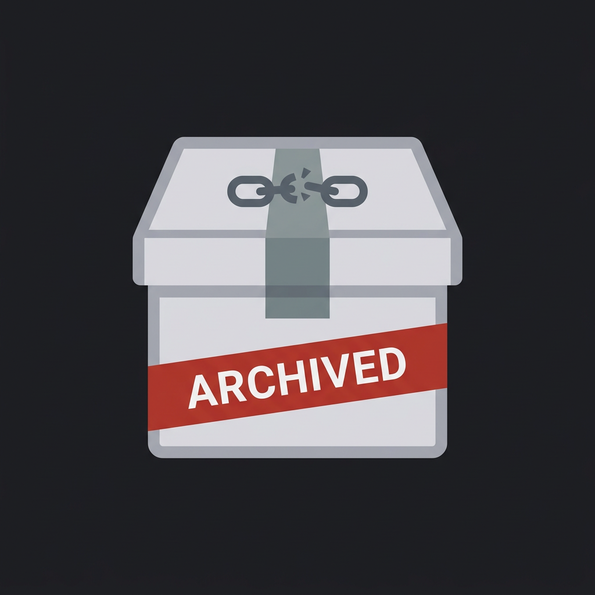

# 🗄️ Bu hesap arşivlendi — kullanılmıyor

> **Durum:** arşivlendi · **Bakım:** yok · **Taşındığı yer:** [`tickwarden-archived`](https://github.com/tickwarden-archived)
>
> Buradaki depolar **ToolkitMC** hesabından çıkarıldı ve arşiv organizasyonuna taşındı.
> Geçmiş (issue, PR, yıldız, release) korunuyor; eski bağlantılar yönlendiriliyor.
> Yeni iş bu hesapta yapılmıyor. Sorular ve geri alma: [`tickwarden-archived/archive-meta`](https://github.com/tickwarden-archived/archive-meta).



### Geri alma

Bu depo salt okunur durumda. Geri almak için `restore/` klasörüne bak:

```bash
export GITHUB_TOKEN=...                        # repo + admin:org
python3 restore/restore.py --list
python3 restore/restore.py --unarchive --apply
python3 restore/restore.py --transfer-back --apply
```

<details>
<summary>Arşivden önceki içerik</summary>

# 🚀 ToolkitMC

Minecraft server yöneticileri ve datapack geliştiricileri için
**modern, hafif ve açık kaynak araçlar**.

<br>

## 📦 Projeler
- **mc-servert-toolkit**
- **macroEngine-dp**
-  **Gulce_AdminPower**
-  **.GCS**
-  **GulceOS-dp**
<br>
  Sunucu yönetimini kolaylaştıran gelişmiş datapack paketi

<br>

## 🛠️ Odak Alanlarımız
- Minecraft Datapack
- Dialog/GUI sistemleri
- Performans ve otomasyon
- Sunucu yönetim araçları

<br>

## 🤝 Katkı
Katkılar açıktır!
- Issue aç
- PR gönder
- Fikir paylaş

<br>


</details>
